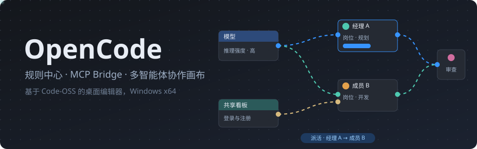
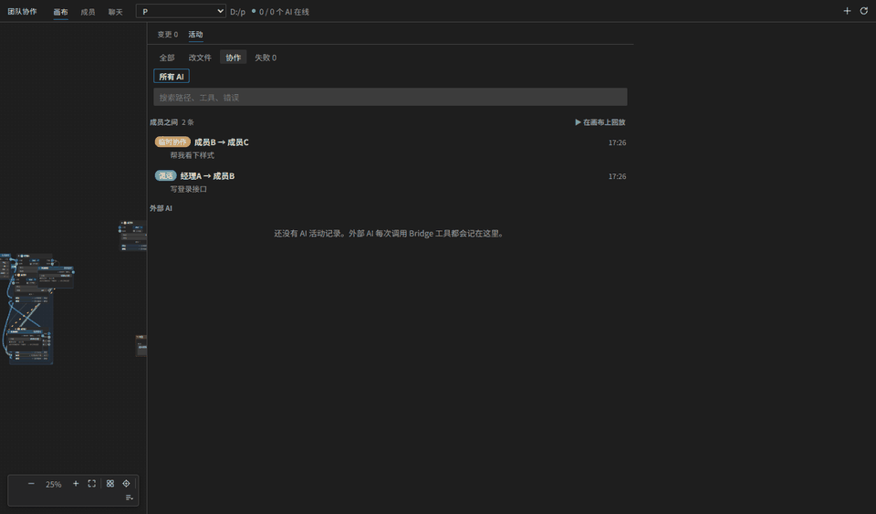
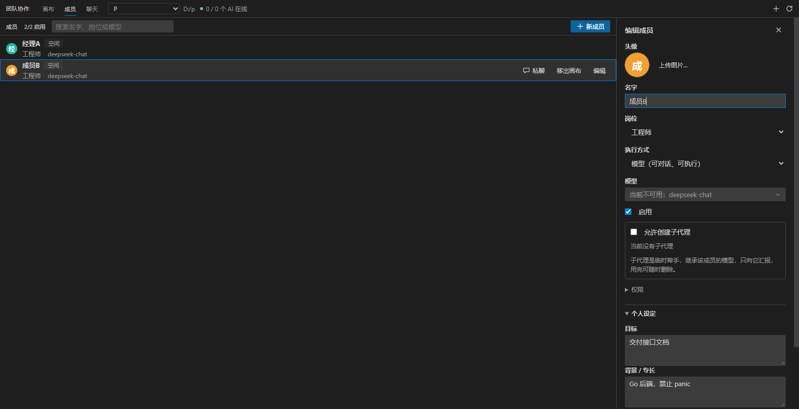

<p align="center">
  
</p>

<p align="center">
  <a href="https://github.com/wdxlg/Opencode-mcp/releases/latest"></a>
  
  
</p>

OpenCode 是一个基于 Code-OSS 的桌面编辑器，把 **规则**、**MCP Bridge** 和 **多智能体协作** 做进了编辑器本身：外部 AI 通过 MCP 接入后遵守同一套规则，多个 AI 成员可以在一张节点画布上分工、协作、互相审查。

## 协作画布

<p align="center">
  
</p>

像 ComfyUI 一样搭团队：每个 AI 成员是一个节点，模型、权限、工具包、共享工作区、文档、规范、看板都是可以接线的接口节点。

- **连线即关系**：下端口连下属，左右端口连协作；接口节点接到成员上就覆盖它自己的设置，断开即恢复
- **双击搜索添加**，右键分类菜单；接口节点直接在节点上改参数
- **分组、折叠、跳过、中继点**，框选、多选连线、复制粘贴
- **活动回放**：派活、交付、打回、临时协作都会在画布上播出来

| 操作 | 快捷键 |
| --- | --- |
| 添加节点 | 双击空白处 |
| 分组 / 改名 | `Ctrl+G` / `F2` |
| 选中组内所有节点 | 双击分组 |
| 折叠 / 跳过 | `Alt+C` / `Ctrl+B` |
| 复制 / 粘贴（带连线） | `Ctrl+C` / `Ctrl+V`（`Ctrl+Shift+V`） |
| 加中继点 | 双击连线 |

## 成员

<p align="center">
  
</p>

每个成员可以单独设岗位、模型、头像、目标和专长，可选是否允许创建子代理。越权写文件会被拒绝，需要批准的操作会先弹窗；主模型出错时自动换备用模型。AI 审查不通过会打回重做，超过轮数再上报给你。

## 规则中心

- 多套规则组，每组多条规则可单独启用、排序，整组交付给 AI
- 工作区可以用通用组，也可以绑定指定组
- 规则存放在固定的共享目录，升级、切换版本都不会丢

## MCP Bridge

- 外部 AI 客户端通过 MCP 接入，先读规则、确认，再动工作区
- 文件、终端、搜索、协作任务等工具开箱即用，内置 Windows-MCP
- 工具调用有超时、长输出落盘、重复调用提醒，终端不会卡在分页或密码提示上

## 下载与运行

1. 从 [Releases](https://github.com/wdxlg/Opencode-mcp/releases/latest) 下载 `OpenCode-*-win-x64.zip`
2. 解压到任意目录，运行 `OpenCode.exe`
3. 想和已有配置完全隔开时，用 `Start-Isolated.cmd` 启动

## 从源码构建

需要 Node.js 22 或更高版本。

```bash
npm run build    # 编译、校验并发布到本目录下的 opencode/
```

产物在 `opencode/`。OpenCode 运行中构建时，新版本会先暂存，下次用 `Start-OpenCode.cmd` 启动时自动替换。

更新记录见 [docs/CHANGELOG.md](docs/CHANGELOG.md)。
